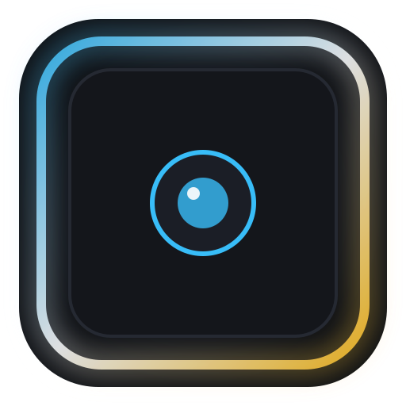

# LumaEdge

<p align="center">
  <br>
  <strong>Virtual Lighting for Linux</strong><br>
  <em>A high-performance, GPU-accelerated virtual edge light and screen ring light for Linux.</em>
</p>

---

## Overview

**LumaEdge** transforms computer monitors into soft, diffused virtual ring lights. Inspired by Apple's macOS Edge Light, LumaEdge illuminates faces during video calls, online meetings, streaming, and recording in low-light environments without requiring bulky external ring-light hardware.

Designed natively for modern Linux desktop environments, LumaEdge provides native Wayland and X11 support, GPU-accelerated shader rendering, smooth corner blending, and zero CPU waste.

---

## ⚡ Quick Install (One Command)

Choose the installation method that fits your setup:

### Option 1: One-Command User Install (Recommended)
Installs LumaEdge directly into your user environment (`~/.local/bin`) and registers it in the **Linux App Drawer** immediately with zero `sudo` required:

```bash
curl -fsSL https://raw.githubusercontent.com/JhaSourav07/ringlight/main/install.sh | bash
```

### Option 2: Fedora RPM (System-Wide via DNF)
Install the verified Fedora package directly:

```bash
sudo dnf install -y https://github.com/JhaSourav07/ringlight/releases/download/v0.1.1/lumaedge-0.1.1-1.fc44.x86_64.rpm
```

### Option 3: Build & Install from Source
```bash
git clone https://github.com/JhaSourav07/ringlight.git
cd ringlight
./install.sh
```

Once installed, **LumaEdge** appears instantly in your GNOME / KDE **Applications Menu / App Drawer**. You can also launch it via terminal:
```bash
lumaedge
```

---

## Features

- **Soft Diffused Edge Illumination:** Realistic radial and cubic falloff across physical screen perimeters. No harsh border lines.
- **Natural Corner Blending:** Seamless arc and corner falloff joining horizontal and vertical light regions.
- **Precision Color Temperature:** Calibrated Planckian blackbody locus conversion from 2700K (Candle) to 6500K (Daylight).
- **Independent Edge Controls:** Configure top, bottom, left, and right illumination independently.
- **Zero Desktop Disruption:** Fullscreen click-through overlay (`Qt::WindowTransparentForInput`) passes 100% of mouse and keyboard events to background applications. Never steals focus.
- **Multi-Monitor Awareness:** Automatically detects connected screens, handles different resolutions and High-DPI scaling, and supports multi-display setups.
- **Optional Ambient Low-Light Auto-Sense:** Local camera-based ambient luminance detection to dynamically adjust brightness. 100% private, no cloud, no frame recording.
- **Pointer-Aware Edge Cutout:** Intelligently dims illumination around the cursor on supported desktop sessions.
- **Premium Charcoal UI:** Minimalist, modern dark dashboard inspired by Linear and Raycast.

---

## Desktop Environment Support

| Environment | Overlay Illumination | Click-Through Input | Focus Invariance | Pointer Cutout |
| :--- | :---: | :---: | :---: | :---: |
| **Fedora GNOME (Wayland)** | Supported | Supported | Supported | Session restricted |
| **Fedora GNOME (X11 / Xwayland)**| Supported | Supported | Supported | Supported |
| **KDE Plasma (Wayland)** | Supported | Supported | Supported | Supported |
| **KDE Plasma (X11)** | Supported | Supported | Supported | Supported |

---

## Manual Build Instructions

### Prerequisites
Fedora Linux:
```bash
sudo dnf install -y gcc-c++ cmake ninja-build \
    qt6-qtbase-devel qt6-qtdeclarative-devel qt6-qtshadertools-devel \
    wayland-devel desktop-file-utils appstream
```

### Build & Run
```bash
cmake -B build -G Ninja -DCMAKE_BUILD_TYPE=Release
cmake --build build
./build/bin/lumaedge
```

### Run Automated Tests
```bash
ctest --test-dir build --output-on-failure
```

---

## Uninstallation

To remove LumaEdge and clear it from your App Drawer:

```bash
# If installed via install.sh:
curl -fsSL https://raw.githubusercontent.com/JhaSourav07/ringlight/main/uninstall.sh | bash

# Or from cloned repository:
./uninstall.sh

# If installed via DNF RPM:
sudo dnf remove lumaedge
```

---

## Architecture

LumaEdge is written in **C++20** and **Qt 6**, adhering to strict modular separation:
- `src/renderer`: GPU shader generation, Planckian colour temperature math, and falloff profiles.
- `src/overlay`: Screen overlay window lifecycle, input transparency, and window manager hints.
- `src/display`: Monitor discovery, DPI scaling, and hotplug monitoring.
- `src/cursor`: Pointer tracking and proximity cutout calculation.
- `src/camera`: Privacy-focused ambient light estimation via V4L2/GStreamer.
- `src/platform`: Wayland and X11 desktop protocol abstraction.
- `qml`: Modern declarative UI and interactive live preview.

---

## License

Distributed under the [MIT License](LICENSE).
